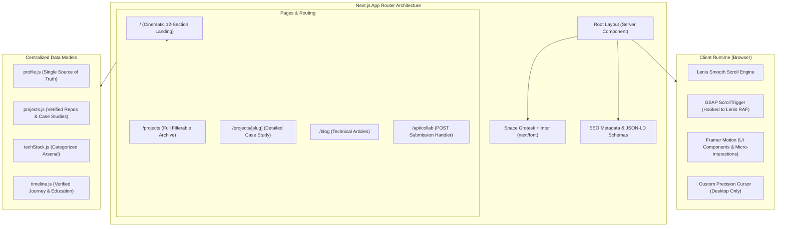

# PORTFOLIO ARCHITECTURE SPECIFICATION
**Developer:** Sampatakumar V  
**Date:** November 2026  
**Framework:** Next.js App Router (ES Modules / JSX)  
**Motion Stack:** GSAP (ScrollTrigger), Framer Motion, Lenis  

---

## 1. System Architecture Overview

The portfolio is architected as a Next.js App Router application designed for maximum visual fidelity, fluid 60fps animations, robust accessibility, and zero-compromise page performance.



---

## 2. Animation Library Division of Responsibilities

To avoid layout thrashing and maintain 60fps performance, animation duties are strictly divided among libraries:

| Library | Specific Responsibilities | Prohibited Usage |
|---|---|---|
| **Lenis** | Global virtual momentum scrolling, normalize wheel/touch delta, provide global RAF hook. | Do not use for DOM mutations or element styling. |
| **GSAP + ScrollTrigger** | Hero entrance timelines, character/word text split reveals, pinned horizontal cards, parallax image scales, scroll progress indicators. | Do not animate state-driven UI popups or dropdowns. Do not animate elements concurrently handled by Framer Motion. |
| **Framer Motion** | Button hover/magnetic gestures, active nav pill transitions, mobile navigation overlay slide-in, modal dialogs, copy-to-clipboard toast notifications. | Do not use for document scroll orchestration or large pinned page sequences. |

---

## 3. Directory & Component Hierarchy

```text
src/
├── app/
│   ├── layout.jsx            # Document shell, font classes, Lenis provider, grain texture
│   ├── page.jsx              # Main home page aggregating sections 01 to 12
│   ├── not-found.jsx         # Custom 404 page
│   ├── robots.js             # Dynamic robots.txt
│   ├── sitemap.js            # Dynamic sitemap.xml
│   ├── api/
│   │   └── collab/
│   │       └── route.js      # Write-only collaboration submission handler
│   ├── projects/
│   │   ├── page.jsx          # Complete interactive project archive
│   │   └── [slug]/
│   │       └── page.jsx      # In-depth case study template (SSH, ResumeAI, Git Reviewer)
│   └── blog/
│       └── page.jsx          # Technical articles archive
├── components/
│   ├── preloader/
│   │   └── Preloader.jsx     # Wordmark counter preloader with smooth clip exit
│   ├── navigation/
│   │   ├── Navbar.jsx        # Fixed backdrop blur navbar with active section pills
│   │   └── MobileMenu.jsx    # Full-screen curtain menu with stagger links
│   ├── hero/
│   │   └── HeroSection.jsx   # Oversized typography, status badge, CTA buttons, scroll cue
│   ├── about/
│   │   └── AboutSection.jsx  # Split editorial layout, genuine portrait, manifesto
│   ├── projects/
│   │   ├── SelectedProjects.jsx # Pinned editorial project showcase
│   │   └── ProjectCard.jsx      # Large featured card with hover image reveal & tags
│   ├── casestudy/
│   │   └── FlagshipSSH.jsx   # Dedicated architectural diagram & deep-dive for SSH
│   ├── stack/
│   │   └── TechnicalArsenal.jsx # Interactive categorized skill matrix with no fake %
│   ├── journey/
│   │   └── ExperienceTimeline.jsx # Education at RGIT, capstone milestones, publication
│   ├── github/
│   │   └── GithubActivity.jsx # Real-time repository metrics, language breakdown, CTA
│   ├── exploring/
│   │   └── CurrentlyExploring.jsx # Modern engineering exploration topics
│   ├── contact/
│   │   ├── ContactSection.jsx # Large headline, verified contact methods, email copy
│   │   └── CollabFormModal.jsx# Interactive project pitch form
│   ├── footer/
│   │   └── Footer.jsx        # Minimal wordmark, copyright, back-to-top interaction
│   └── motion/
│       ├── SmoothScrollProvider.jsx # Lenis setup synchronized with GSAP ScrollTrigger
│       ├── CustomCursor.jsx  # Precision magnetic dot & ring cursor (desktop only)
│       └── MotionToggle.jsx  # Accessible animation toggle (prefers-reduced-motion)
├── data/
│   ├── profile.js            # Central profile configuration
│   ├── projects.js           # Verified projects list & case study deep-dives
│   ├── techStack.js          # Categorized technical skills
│   └── timeline.js           # Verified milestones & education
└── styles/
    └── globals.css           # Global tokens, dark theme reset, typography clamp utilities
```

---

## 4. Design Tokens & Visual Hierarchy

### Color Tokens
```css
:root {
  --bg-primary: #080808;       /* Deep obsidian canvas */
  --bg-secondary: #111111;     /* Sub-surface void */
  --bg-surface: #171717;       /* Interactive card surface */
  --text-primary: #F5F3EF;     /* Warm editorial white */
  --text-secondary: #999999;   /* Controlled muted text */
  --accent-orange: #FF6538;    /* Precision accent */
  --accent-orange-glow: rgba(255, 101, 56, 0.25);
  --border-subtle: rgba(255, 255, 255, 0.12);
  --border-hover: rgba(255, 255, 255, 0.28);
}
```

### Fluid Typography Scale (`clamp()`)
- **Display 1 (Hero Title):** `clamp(3.2rem, 9vw, 9.5rem)`
- **Display 2 (Section Headings):** `clamp(2.4rem, 5.5vw, 5.5rem)`
- **Heading 3 (Card Titles):** `clamp(1.4rem, 2.5vw, 2.4rem)`
- **Body Large:** `clamp(1.05rem, 1.4vw, 1.25rem)`
- **Body Regular:** `clamp(0.875rem, 1.1vw, 1rem)`
- **Mono Labels / Tags:** `clamp(0.7rem, 0.85vw, 0.825rem)`

---

## 5. Performance & Accessibility Architecture

1. **Core Web Vitals:**
   - Preconnect to Google Fonts via `next/font/google`.
   - Priority loading for Hero and Profile images with optimized WebP/AVIF formats.
   - Non-blocking asynchronous loading for GSAP and Lenis scripts.
2. **Accessibility (WCAG AA):**
   - Minimum 4.5:1 text-to-background contrast ratio (`#F5F3EF` on `#080808` provides 17.5:1 contrast).
   - Semantic HTML5 sectioning (`header`, `nav`, `main`, `section`, `article`, `footer`).
   - Native keyboard accessibility (Tab, Enter, Escape) for all buttons, links, and modal dialogs.
   - Respects `prefers-reduced-motion: reduce` by disabling smooth scroll and heavy GSAP transforms.

